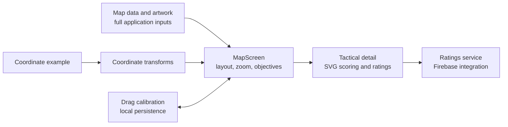

# Call of Duty: Black Ops 7 Tactical Map App 

Selected engineering work from **BO7 Tactical Map Guide**, an Expo and React Native application for exploring tactical maps, strategic points of interest, and game-mode objectives.

Created and owned by Adolph White Jr., including the requirements, architecture, map interaction and calibration model, and code review. Built with the use of AI tools.

The engineering challenge is keeping map imagery, interactive markers, labels, and tactical detail views aligned while the viewport, orientation, and zoom level change. This repository exposes the application code behind that work, together with an executable coordinate example that needs no external service.

## Review the engineering

| Area | Source | What to look for |
| --- | --- | --- |
| Interactive map | [MapScreen.tsx](client/screens/MapScreen.tsx) | Coordinate transforms, zoom and pan, objective layers, calibration state, and responsive layout |
| Drag calibration | [CalibratableDot.tsx](client/components/CalibratableDot.tsx), [CalibratableLabel.tsx](client/components/CalibratableLabel.tsx) | Gesture handling and coordinate updates |
| Label placement | [POIMarkerLabel.tsx](client/components/POIMarkerLabel.tsx) | Measured labels, marker relationships, and SVG connectors |
| Tactical detail | [POIDetailModal.tsx](client/screens/POIDetailModal.tsx), [SAMRadarChart.tsx](client/components/SAMRadarChart.tsx) | Modal interaction, visual scoring, and structured strategy presentation |
| Ratings | [ratingsService.ts](client/services/ratingsService.ts) | Transaction-based aggregates, subscriptions, and local user state |
| Navigation | [RootStackNavigator.tsx](client/navigation/RootStackNavigator.tsx) | Typed screen parameters and detail-screen flow |
| Coordinate engine | [map-coordinate-algorithm.js](scripts/map-coordinate-algorithm.js) | Forward/inverse transforms, pixel conversion, and aspect-preserving layout |

## Five-minute source walkthrough

1. **Start with the interaction model:** open [MapScreen.tsx](client/screens/MapScreen.tsx) and find `rawToDisplay` / `displayToRaw`. The engineering decision is to keep stored playable-area positions distinct from image-space positions.
2. **Follow the user action:** review [CalibratableDot.tsx](client/components/CalibratableDot.tsx) and [POIMarkerLabel.tsx](client/components/POIMarkerLabel.tsx) to see how dragging and readable labels connect to those positions.
3. **Follow the content:** open [POIDetailModal.tsx](client/screens/POIDetailModal.tsx) and [ratingsService.ts](client/services/ratingsService.ts) for the detail-screen and state-update boundaries.
4. **Run the focused example below:** six checks exercise the coordinate module directly.

Continue with the [engineering walkthrough](docs/ENGINEERING_WALKTHROUGH.md) for the data flow and design tradeoffs.



## Run the coordinate example

From the repository root, with Node.js 20 or later:

```sh
node --test examples/coordinate-review.test.js
```

Alternatively, run `npm test`. No dependency installation, account, model, image download, or network access is required.

Six checks exercise asymmetric border offsets, inverse conversion, pixel conversion, portrait and landscape layout, and maps without offsets. The example imports the existing coordinate module unchanged; it demonstrates those calculations, not the full mobile interface.

## My contribution

I led the product definition, architecture, implementation direction, and validation of the tactical-map application, working with AI-assisted engineering tools. My work included the map interaction model, coordinate and calibration requirements, strategic-content presentation, and review of the resulting implementation. The implementation and review process used AI-assisted engineering; the selected source shows the resulting work.

## Scope and continuing development

This is an engineering review package for a product that remains under development. The application source is preserved as selected from the project; the runnable portion is the standalone coordinate example. The full Expo application, game artwork, tactical-content datasets, service configuration, and deployment workflow are not distributed here.

The source references the omitted image registry, map datasets, and Firebase configuration where they belong in the full application. See [source selection and dependencies](docs/SOURCE_SELECTION.md) for those boundaries and the retained external integrations.

Call of Duty and Black Ops are third-party game names used to identify the project subject. This package includes no game artwork and makes no claim of publisher affiliation.
